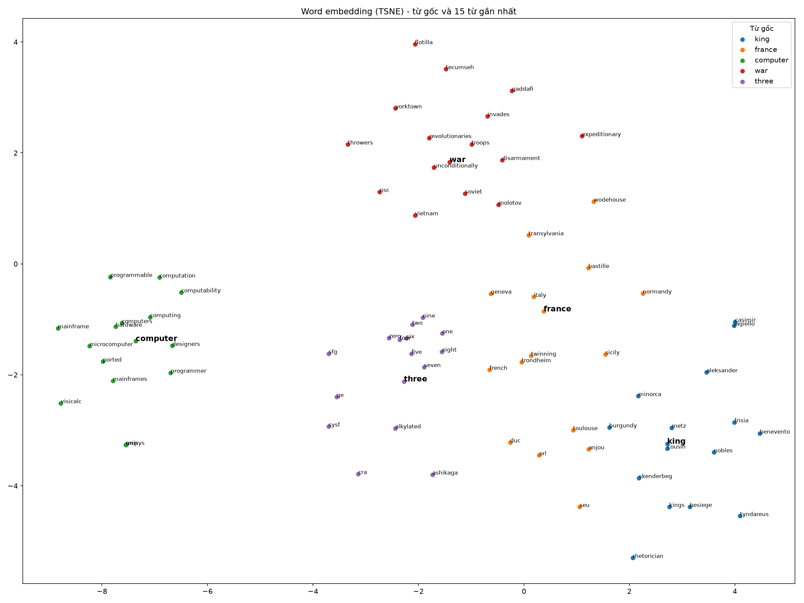

# Báo cáo: Word Embedding bằng Skip-gram với Negative Sampling

## 1. Giới thiệu

Máy tính không xử lý trực tiếp ý nghĩa của chữ viết. Vì vậy, trong các bài toán xử lý ngôn ngữ tự nhiên, mỗi từ thường được chuyển thành một vector số để mô hình có thể tính toán. Cách biểu diễn one-hot khá đơn giản nhưng có hai hạn chế: vector có số chiều bằng kích thước từ điển và phần lớn giá trị bằng 0; đồng thời, cách biểu diễn này không thể hiện mức độ liên quan về nghĩa giữa các từ.

Word embedding khắc phục những hạn chế đó bằng cách học vector đặc, có số chiều nhỏ hơn. Trong báo cáo này, mỗi từ được biểu diễn bằng vector 100 chiều. Các từ thường xuất hiện trong những ngữ cảnh tương tự được kỳ vọng có vector gần nhau. Cách tiếp cận này dựa trên giả thuyết phân bố: ý nghĩa của một từ có thể được suy ra một phần từ những từ thường xuất hiện xung quanh nó.

Bài thực hành triển khai mô hình **Skip-gram với Negative Sampling** bằng PyTorch, huấn luyện trên tập dữ liệu text8, sau đó đánh giá các vector đã học và trực quan hóa chúng.

## 2. Phương pháp

### 2.1. Mô hình Skip-gram

Skip-gram sử dụng một từ trung tâm để dự đoán các từ xuất hiện trong ngữ cảnh xung quanh. Với mỗi từ, mô hình duy trì hai vector:

- `v`: vector của từ khi đóng vai trò từ trung tâm, lưu trong bảng `in_embed`.
- `u`: vector của từ khi đóng vai trò từ ngữ cảnh, lưu trong bảng `out_embed`.

Trong quá trình huấn luyện, mô hình điều chỉnh hai bảng vector để phân biệt các cặp từ thực sự xuất hiện cùng nhau với những cặp được lấy ngẫu nhiên. Sau huấn luyện, bảng `in_embed` được dùng làm biểu diễn embedding cuối cùng.

### 2.2. Negative Sampling

Nếu dùng Softmax trên toàn bộ từ điển hơn 30.000 từ, mỗi bước cập nhật sẽ tốn nhiều phép tính. Negative Sampling giảm chi phí bằng cách chỉ học trên một cặp dương và một số lượng nhỏ cặp âm.

Với cặp thật gồm từ trung tâm \(c\) và từ ngữ cảnh \(o\), mô hình lấy thêm \(K=5\) từ làm mẫu âm \(n_1,\ldots,n_K\). Hàm mất mát là:

\[
L=-\log \sigma(u_o^\top v_c)-\sum_{k=1}^{K}\log \sigma(-u_{n_k}^\top v_c)
\]

Trong đó, \(\sigma\) là hàm sigmoid. Thành phần thứ nhất khuyến khích mô hình tăng tích vô hướng giữa vector của cặp từ thật; thành phần thứ hai khuyến khích giảm tích vô hướng giữa từ trung tâm và các từ âm.

Các từ âm được lấy theo phân phối:

\[
P(w)\propto f(w)^{0.75}
\]

với \(f(w)\) là tần suất xuất hiện của từ. Số mũ 0,75 làm phân phối bớt lệ thuộc vào các từ phổ biến so với việc lấy mẫu trực tiếp theo tần suất.

### 2.3. Subsampling

Những từ rất phổ biến như `the`, `of` và `and` xuất hiện nhiều nhưng thường cung cấp ít thông tin phân biệt cho từng ngữ cảnh. Để giảm ảnh hưởng của chúng, mô hình áp dụng subsampling. Mỗi lần xuất hiện của từ \(w\) được giữ lại với xác suất:

\[
P_{\text{keep}}(w)=\min\left(1,\sqrt{\frac{t}{f(w)}}\right), \qquad t=10^{-5}
\]

Cách xử lý này giảm số lượng mẫu từ phổ biến trước khi tạo cặp huấn luyện, qua đó hạn chế dữ liệu dư thừa và giảm thời gian tính toán.

## 3. Dữ liệu và cấu hình thực nghiệm

Thí nghiệm sử dụng text8, một tập văn bản tiếng Anh đã được làm sạch, gồm khoảng 17 triệu từ. Văn bản được chuyển thành chữ thường và các chữ số được viết thành chữ.

Cấu hình chính của mô hình:

| Thành phần | Thiết lập |
|---|---|
| Tập dữ liệu | text8 |
| Kích thước embedding | 100 chiều |
| Số mẫu âm | 5 |
| Kích thước batch | 4096 |
| Bộ tối ưu | Adam |
| Learning rate | 0,003 |
| Số epoch | 5 |
| Cửa sổ ngữ cảnh | Lấy ngẫu nhiên từ 1 đến 5 |
| Phần cứng | MacBook Air dùng Apple Silicon, chạy trên GPU MPS |

Từ điển loại bỏ các từ có tần suất thấp hơn ngưỡng `min_count`. Cửa sổ ngữ cảnh được chọn ngẫu nhiên trong khoảng 1–5; các từ gần từ trung tâm có cơ hội được lấy làm ngữ cảnh nhiều hơn các từ ở xa.

Mã nguồn được chia thành các phần: `data.py` xử lý dữ liệu, `model.py` định nghĩa và huấn luyện mô hình, `evaluate.py` đánh giá embedding, còn `visualize.py` tạo biểu đồ trực quan hóa.

## 4. Kết quả thực nghiệm

Hai cấu hình được dùng để quan sát ảnh hưởng của lượng dữ liệu và ngưỡng loại từ hiếm. Vì cả hai yếu tố đều thay đổi giữa hai thí nghiệm, kết quả chỉ cho phép so sánh tổng thể giữa hai cấu hình, chưa thể xác định riêng tác động của từng yếu tố.

| Chỉ số | Thí nghiệm A | Thí nghiệm B (mô hình cuối) |
|---|---:|---:|
| Số từ đọc | 5.000.000 | Toàn bộ text8, khoảng 17.000.000 |
| `min_count` | 5 | 20 |
| Kích thước từ điển | 36.280 | 31.888 |
| Số từ sau subsampling | 1.286.717 | Chưa có số liệu trong nội dung đầu vào |
| Số cặp huấn luyện | 7.722.365 | Chưa có số liệu trong nội dung đầu vào |
| Thời gian mỗi epoch | Khoảng 37 giây | Chưa có số liệu trong nội dung đầu vào |

Các ô chưa có số liệu cần được bổ sung từ log thực tế của lần chạy thí nghiệm B; không nên suy đoán các giá trị này.

### 4.1. Diễn biến hàm mất mát

Loss trung bình của thí nghiệm A qua 5 epoch:

| Epoch | Loss |
|---:|---:|
| 1 | 2,5634 |
| 2 | 2,1600 |
| 3 | 1,9908 |
| 4 | 1,8958 |
| 5 | 1,8415 |

Loss giảm qua từng epoch, cho thấy mô hình tiếp tục cải thiện trên mục tiêu huấn luyện. Mức giảm nhỏ dần: từ 0,4034 giữa epoch 1 và 2 xuống còn 0,0543 giữa epoch 4 và 5. Sau 5 epoch, loss vẫn giảm nên chưa đủ cơ sở để kết luận mô hình đã hội tụ hoàn toàn.

Biểu đồ loss của thí nghiệm B được lưu tại `images/loss.png`. Các giá trị loss theo từng epoch cần được điền từ `loss.json` để hoàn thiện phần so sánh.

### 4.2. Các từ gần nhau theo cosine similarity

Với mô hình B, các từ gần nhất được truy xuất bằng độ tương đồng cosine. Bảng dưới đây ghi lại 5 từ gần nhất cho mỗi từ truy vấn.

| Từ truy vấn | Các từ gần nhất (cosine similarity) |
|---|---|
| `king` | `throne` (0,66), `prince` (0,66), `heir` (0,62), `xiii` (0,60), `iii` (0,60) |
| `france` | `paris` (0,67), `french` (0,65), `spain` (0,61), `gaulle` (0,60), `versailles` (0,59) |
| `computer` | `computers` (0,72), `hardware` (0,70), `computing` (0,68), `ibm` (0,66), `software` (0,64) |
| `war` | `outbreak` (0,67), `army` (0,66), `allied` (0,65), `invasion` (0,65), `allies` (0,64) |
| `three` | `four` (0,90), `two` (0,88), `five` (0,87), `zero` (0,87), `one` (0,84) |
| `music` | `musicians` (0,75), `musical` (0,71), `melodic` (0,64), `genres` (0,64), `folk` (0,64) |
| `city` | `town` (0,73), `cities` (0,68), `suburbs` (0,66), `downtown` (0,61), `towns` (0,61) |

Kết quả cho thấy các vector đã nắm bắt được một số quan hệ ngữ nghĩa và quan hệ đồng xuất hiện. Chẳng hạn, `computer` gần với `hardware`, `software` và `computing`; `three` gần với các số đếm khác; còn `france` gần với `paris` và `french`.

Tuy nhiên, độ tương đồng cao không đồng nghĩa hai từ luôn đồng nghĩa. Một số từ gần nhau do thường xuất hiện trong cùng ngữ cảnh hoặc trong các cấu trúc văn bản tương tự.

### 4.3. Đánh giá phép toán tương tự từ

Phép toán vector được dùng để kiểm tra quan hệ \(a:b::c:?\) theo công thức:

\[
\mathbf{v}_{\text{đáp án}} \approx \mathbf{v}_b-\mathbf{v}_a+\mathbf{v}_c
\]

Ba từ đầu vào được loại khỏi danh sách ứng viên. Trên 19 phép kiểm tra, kết quả đạt **top-1: 7/19 (37%)** và **top-5: 10/19 (53%)**.

Các phép toán có đáp án đúng ở vị trí đầu tiên:

| Quan hệ đầu vào | Kết quả top-1 |
|---|---|
| `france : paris :: england : ?` | `london` |
| `russia : moscow :: france : ?` | `paris` |
| `france : french :: germany : ?` | `german` |
| `france : french :: italy : ?` | `italian` |
| `big : bigger :: small : ?` | `smaller` |
| `brother : sister :: son : ?` | `daughter` |
| `he : she :: his : ?` | `her` |

Một số phép toán chỉ tìm thấy đáp án trong top-5. Với `france:paris::germany:?`, kết quả đầu tiên là `munich`, trong khi `berlin` xuất hiện trong top-5. Với `one:two::three:?`, kết quả đầu tiên là `zero`, nhưng `four` nằm trong top-5. Với `january:february::march:?`, kết quả đầu tiên là `june`, còn `april` nằm trong top-5.

Một số quan hệ không được mô hình xử lý chính xác. Ví dụ, `man:king::woman:?` trả về các từ như `throne`, `concubine` và `brother`, thay vì `queen`; `france:paris::italy:?` trả về `venice` và `florence`, thay vì `rome`. Các phép toán `usa:dollar::japan:?`, `good:better::bad:?`, `walk:walked::go:?`, `sun:day::moon:?` và `long:longer::short:?` cũng không cho kết quả đúng.

Tỷ lệ top-1 cho thấy mô hình có thể biểu diễn một số quan hệ đều đặn, chẳng hạn quan hệ quốc gia–quốc tịch hoặc biến đổi giới tính trong đại từ. Dù vậy, khả năng suy ra quan hệ bằng phép toán vector vẫn chưa ổn định trên tập kiểm tra nhỏ này.

### 4.4. Trực quan hóa embedding bằng t-SNE

t-SNE được dùng để chiếu vector nhiều chiều xuống mặt phẳng hai chiều. Mỗi biểu đồ gồm 5 từ gốc (`king`, `france`, `computer`, `war`, `three`) cùng 15 từ gần nhất của mỗi nhóm.

**Thí nghiệm A** (`min_count = 5`, sử dụng 5 triệu từ): các nhóm đã có xu hướng tách biệt nhưng còn nhiễu. Nhóm quanh `three` chứa những từ ít liên quan như `sfg`, `qe`, `sysf` và `alkylated`; nhóm quanh `king` và `france` cũng xuất hiện `wodehouse`, `tyndareus`. Những từ hiếm có thể chưa có đủ ngữ cảnh để tạo vector ổn định.

**Thí nghiệm B** (`min_count = 20`, sử dụng toàn bộ dữ liệu): các nhóm tập trung đúng chủ đề hơn. Nhóm `king` có `queen`, `prince`, `monarch`, `heir`, `throne` và `crowned`; nhóm `france` có các nước như `spain`, `italy`, `germany`, `austria`, `belgium`, cùng với `paris`, `napoleon` và `louis`. Nhóm `computer` tập trung quanh `software`, `hardware`, `ibm` và `databases`; nhóm `war` có `battle`, `fought`, `invasion`, `army`, `troops` và `wwii`. Nhóm `three` chủ yếu gồm các số từ `zero` đến `nine`, cùng một số từ chỉ tháng.

So sánh trực quan cho thấy cấu hình B tạo ra các nhóm từ phù hợp với chủ đề hơn. Tuy nhiên, do lượng dữ liệu và `min_count` cùng thay đổi, chưa thể kết luận mức cải thiện đến từ riêng yếu tố nào.

## 5. Phân tích và hạn chế

### 5.1. Ảnh hưởng của dữ liệu và ngưỡng tần suất

Thí nghiệm B cho kết quả trực quan gọn và đúng chủ đề hơn thí nghiệm A. Việc sử dụng toàn bộ text8 cung cấp thêm ngữ cảnh, còn nâng `min_count` từ 5 lên 20 loại bớt những từ hiếm có vector kém ổn định. Hai thay đổi được thực hiện đồng thời, vì vậy cần thêm thí nghiệm kiểm soát nếu muốn đo riêng ảnh hưởng của từng yếu tố.

### 5.2. Khả năng biểu diễn quan hệ từ

Mô hình nhận diện tương đối tốt các nhóm từ có ngữ cảnh tương tự, như số đếm, địa danh và thuật ngữ máy tính. Kết quả analogy lại thấp hơn: top-1 chỉ đạt 37% trên 19 câu hỏi. Điều này cho thấy khả năng gom nhóm từ không đồng nghĩa với việc mô hình thực hiện tốt các phép toán quan hệ trên vector.

### 5.3. Quy mô dữ liệu và tần suất từ

text8 có khoảng 17 triệu từ, nhỏ hơn đáng kể so với các corpus quy mô hàng tỷ từ được sử dụng trong những nghiên cứu Word2Vec ban đầu. Các từ ít xuất hiện như `worse`, `went`, `yen` và `shorter` có thể không có đủ ngữ cảnh để tạo vector đáng tin cậy.

Ngoài ra, ngữ cảnh trong corpus ảnh hưởng trực tiếp đến vector. Chẳng hạn, `king` có thể thường xuất hiện trong tên vua như `louis xiii` hoặc `henry iii`, khiến vector gần các chữ số La Mã hơn là gần `man`. Đây là một ví dụ cho thấy embedding phản ánh cách từ được dùng trong dữ liệu, chứ không chỉ phản ánh định nghĩa từ điển.

### 5.4. Giới hạn của t-SNE

t-SNE hỗ trợ quan sát cấu trúc cục bộ, nhưng khoảng cách giữa các cụm và vị trí tuyệt đối trên hai trục không có ý nghĩa ngữ nghĩa trực tiếp. Vì vậy, không nên kết luận rằng hai chủ đề ít liên quan chỉ dựa trên việc chúng nằm xa nhau trên biểu đồ.

### 5.5. Giới hạn của đánh giá

Bộ kiểm tra analogy chỉ gồm 19 phép toán nên chưa đại diện đầy đủ cho chất lượng embedding. Kết quả hiện tại phù hợp để kiểm tra chức năng và nhận diện điểm mạnh, điểm yếu ban đầu; chưa đủ để khái quát hóa hiệu năng. Các lần đánh giá tiếp theo nên bổ sung bộ chuẩn như WordSim-353 và bộ Google analogy test, đồng thời ghi rõ quy trình tiền xử lý và cách xử lý từ ngoài từ điển.

## 6. Kết luận và hướng phát triển

Mô hình Skip-gram với Negative Sampling đã được cài đặt bằng PyTorch và huấn luyện trên text8. Kết quả cho thấy embedding có khả năng gom các từ cùng chủ đề hoặc có ngữ cảnh tương tự thành nhóm. Mô hình cũng giải được một phần phép toán quan hệ từ, nhưng độ chính xác top-1 trên tập kiểm tra hiện tại mới đạt 37%.

Các hướng phát triển tiếp theo gồm:

1. Cài đặt CBOW và so sánh với Skip-gram về thời gian huấn luyện và chất lượng embedding.
2. Thử các kích thước vector 50, 200 và 300 chiều; thay đổi kích thước cửa sổ ngữ cảnh và số mẫu âm.
3. Tăng số epoch hoặc sử dụng corpus lớn hơn, chẳng hạn dữ liệu Wikipedia.
4. Đánh giá bằng các bộ dữ liệu chuẩn như WordSim-353 và Google analogy test.
5. Thử nghiệm trên tiếng Việt, có bước tách từ phù hợp, chẳng hạn dùng `underthesea` hoặc `pyvi`.

Trước khi chốt báo cáo, cần bổ sung số từ sau subsampling, số cặp huấn luyện, thời gian mỗi epoch và loss theo từng epoch của thí nghiệm B từ log thực tế. Không nên điền các số liệu này bằng ước lượng.

## Tài liệu tham khảo

1. T. Mikolov, K. Chen, G. Corrado, J. Dean. “Efficient Estimation of Word Representations in Vector Space.” 2013.
2. T. Mikolov, I. Sutskever, K. Chen, G. Corrado, J. Dean. “Distributed Representations of Words and Phrases and their Compositionality.” NeurIPS, 2013.
3. L. van der Maaten, G. Hinton. “Visualizing Data using t-SNE.” *Journal of Machine Learning Research*, 2008.
