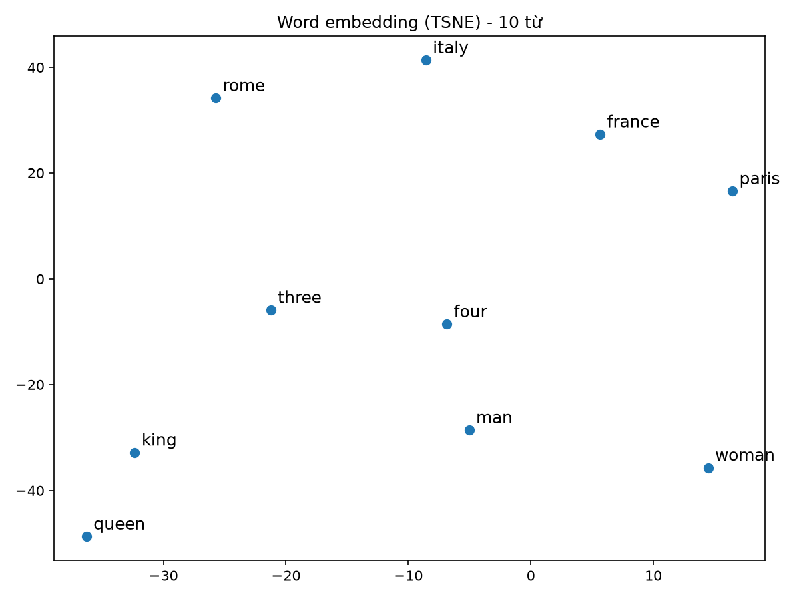

# Báo cáo: Word Embedding bằng Skip-gram với Negative Sampling

**Mã nguồn:** https://github.com/datnk0116/embedding

## 1. Giới thiệu

Máy tính không xử lý trực tiếp ý nghĩa của chữ viết, nên trong xử lý ngôn ngữ tự nhiên mỗi từ được chuyển thành dạng số. Cách đơn giản nhất là biểu diễn mỗi từ như một ký hiệu rời rạc bằng vector one-hot, có số chiều bằng kích thước từ vựng (hàng chục nghìn). Hai vector one-hot luôn trực giao, nên cách này không có khái niệm tương đồng tự nhiên giữa các từ.

Word vector khắc phục điều này: mỗi từ là một vector dày đặc, ít chiều, được chọn sao cho gần với vector của các từ xuất hiện trong ngữ cảnh tương tự. Cách làm dựa trên giả thuyết phân bố: các từ xuất hiện trong ngữ cảnh tương tự thì có nghĩa tương tự (Harris, 1954). Word vector còn được gọi là word embedding. Bài thực hành cài đặt mô hình **Skip-gram** (word2vec) với **negative sampling** (Mikolov và cộng sự, 2013) bằng PyTorch, huấn luyện trên ngữ liệu text8 và trực quan hóa 10 từ bằng t-SNE.

## 2. Phương pháp

### 2.1. Mô hình Skip-gram

Skip-gram dự đoán các từ ngữ cảnh khi biết từ trung tâm. Mô hình duyệt từng vị trí trong ngữ liệu; mỗi vị trí có một từ trung tâm $c$ và các từ ngữ cảnh $o$ nằm trong cửa sổ ngữ cảnh quanh nó. Mỗi từ trong từ vựng có hai word vector 100 chiều:

- $v$: vector khi từ đóng vai trò từ trung tâm (bảng `in_embed`).
- $u$: vector khi từ đóng vai trò từ ngữ cảnh (bảng `out_embed`).

Mỗi bảng là một ma trận trọng số, đóng vai trò bảng tra word vector. Sau huấn luyện, bảng `in_embed` được dùng làm embedding cuối cùng (không lấy trung bình với $u$). Khởi tạo giống bản word2vec gốc: `in_embed` lấy ngẫu nhiên đều trong khoảng $[-0{,}5/d,\ 0{,}5/d]$ với $d$ là số chiều, còn `out_embed` bằng 0.

### 2.2. Negative Sampling

Với naive softmax, xác suất của từ ngữ cảnh phải được tính trên toàn bộ từ vựng (31.888 từ), nên mỗi bước cập nhật tốn kém. Negative sampling thay bằng bài toán phân biệt cặp dương với các cặp âm: mỗi bước dùng một từ dương và $K=5$ từ âm, nên về nguyên tắc chỉ cần cập nhật $K+2$ vector thay vì $|V|+1$ vector. Với từ trung tâm $c$, từ dương $o$ và các từ âm $n_1,\dots,n_K$, hàm mất mát của một cặp huấn luyện là:

$$
L=-\log \sigma(u_o^\top v_c)-\sum_{k=1}^{K}\log \sigma(-u_{n_k}^\top v_c)
$$

Thành phần đầu làm tăng tích vô hướng của cặp dương, thành phần sau làm giảm tích vô hướng giữa từ trung tâm và các từ âm. Các từ âm được lấy theo phân phối $P(w)\propto f(w)^{0{,}75}$, với $f(w)$ là tần suất của từ; số mũ 0,75 giảm bớt ưu thế của các từ phổ biến.

Vì `out_embed` khởi tạo bằng 0, mọi tích vô hướng ban đầu bằng 0 và mất mát ban đầu là $6\ln 2 \approx 4{,}16$.

### 2.3. Tạo cặp huấn luyện

Các từ xuất hiện dưới `min_count` lần bị loại khỏi từ vựng và khỏi chuỗi từ trước khi tạo cặp. Với mỗi vị trí, kích thước cửa sổ ngữ cảnh được chọn ngẫu nhiên từ 1 đến 5; mỗi từ ngữ cảnh trong cửa sổ cho một cặp huấn luyện $(c, o)$, nên từ gần từ trung tâm được lấy nhiều hơn từ ở xa.

## 3. Ngữ liệu và cấu hình

Ngữ liệu là text8, gồm khoảng 17 triệu từ tiếng Anh đã làm sạch (chữ thường, chữ số viết thành chữ). Mô hình cuối cùng dùng 17.000.000 từ đầu tiên.

| Thành phần | Giá trị |
|---|---|
| Số từ đọc | 17.000.000 |
| `min_count` | 20 |
| Kích thước từ vựng | 31.888 |
| Số cặp huấn luyện | 98.085.919 |
| Số chiều word vector | 100 |
| Số từ âm | 5 |
| Cửa sổ ngữ cảnh | ngẫu nhiên 1–5 |
| Batch size | 4096 (23.946 bước mỗi epoch) |
| Bộ tối ưu | Adam, learning rate 0,003 |
| Số epoch | 5 |
| Phần cứng | MacBook Air Apple Silicon, GPU MPS |

Mã nguồn gồm `data.py` (ngữ liệu và cặp huấn luyện), `model.py` (Skip-gram và huấn luyện) và `visualize.py` (vẽ 10 từ); lệnh chạy chi tiết có trong README của repo: https://github.com/datnk0116/embedding

## 4. Kết quả

### 4.1. Diễn biến mất mát

Mất mát trung bình của từng epoch (tính trên toàn bộ các batch):

| Epoch | Mất mát | Giảm so với epoch trước |
|---:|---:|---:|
| 1 | 2,2581 | – |
| 2 | 2,2140 | 0,0441 |
| 3 | 2,2094 | 0,0046 |
| 4 | 2,2080 | 0,0014 |
| 5 | 2,2072 | 0,0008 |

Mất mát giảm mạnh từ giá trị ban đầu khoảng 4,16 xuống khoảng 2,26 sau epoch 1, sau đó đi ngang: từ epoch 3 trở đi mỗi epoch chỉ giảm dưới 0,005. Vì vậy tăng thêm số epoch với cấu hình này ít cải thiện kết quả.

### 4.2. Trực quan hóa 10 từ bằng t-SNE

Word vector 100 chiều của 10 từ `king, queen, man, woman, france, paris, italy, rome, three, four` được giảm chiều xuống 2 chiều bằng t-SNE (perplexity 5, khởi tạo PCA, `random_state=0`).

Quan sát trên hình:

- Các từ tạo thành ba cụm: bốn địa danh (`rome`, `italy`, `france`, `paris`), hai số đếm (`three`, `four`), và bốn từ chỉ người hoặc chức danh (`king`, `queen`, `man`, `woman`).
- Các cặp có quan hệ rõ rệt nằm gần nhau: `king`–`queen`, `three`–`four`, `france`–`paris`, `italy`–`rome`. Trong cụm địa danh, `paris` gần `france` hơn gần `italy`, và `rome` gần `italy` hơn gần `france`.
- `man` và `woman` nằm cùng cụm với `king`, `queen` nhưng không gần nhau bằng cặp `king`–`queen`.

Hình cho thấy embedding đã gom các từ theo chủ đề và theo quan hệ, dù mô hình chỉ học từ ngữ cảnh xuất hiện của từ.

## 5. Nhận xét và hạn chế

- **Tính minh họa của hình:** 10 từ được chọn có chủ đích, theo các cặp đã có quan hệ sẵn, nên hình chỉ minh họa chứ không phải đánh giá khách quan. Báo cáo chưa có đánh giá nội tại định lượng (độ tương đồng cosine, analogy) và chưa có đánh giá ngoại tại.
- **Giới hạn của phép chiếu:** mọi phép chiếu đều làm mất một phần thông tin, nên quan hệ thấy trên hình 2D chỉ mang tính gợi ý; khoảng cách giữa các cụm của t-SNE không đáng tin. Với chỉ 10 điểm, bố cục còn phụ thuộc vào tham số và hạt giống ngẫu nhiên.
- **Tương đồng và liên quan:** hai từ tương đồng khi chia sẻ nhiều đặc điểm nghĩa (`three`–`four`), còn hai từ liên quan khi thường xuất hiện trong cùng một tình huống (`france`–`paris`). Embedding dựa trên đồng xuất hiện không tách biệt được hai quan hệ này, nên việc hai từ gần nhau chưa cho biết chúng tương đồng hay liên quan.
- **Quy mô ngữ liệu:** text8 chỉ khoảng 17 triệu từ, nhỏ hơn nhiều so với ngữ liệu hàng tỷ từ trong nghiên cứu gốc, nên các từ ít xuất hiện có thể có word vector kém chất lượng.
- **Embedding tĩnh:** mỗi từ chỉ có một vector, nên vector của từ đa nghĩa là sự pha trộn của mọi nghĩa.
- **Hội tụ:** mất mát đi ngang sau epoch 2, nên cấu hình hiện tại có vẻ đã đạt giới hạn trên ngữ liệu này; muốn cải thiện thêm cần đổi ngữ liệu hoặc tham số.

## 6. Kết luận

Mô hình Skip-gram với negative sampling đã được cài đặt từ đầu bằng PyTorch và huấn luyện trên ngữ liệu text8 với từ vựng 31.888 từ và word vector 100 chiều. Mất mát giảm từ khoảng 4,16 xuống 2,21 và đi ngang từ epoch 3. Hình t-SNE của 10 từ cho thấy các từ cùng chủ đề và các cặp có quan hệ (vua–nữ hoàng, nước–thủ đô, số đếm liên tiếp) nằm gần nhau. Hướng mở rộng gồm đánh giá nội tại bằng độ tương đồng cosine và analogy, so sánh với CBOW và GloVe, đổi số chiều và kích thước cửa sổ ngữ cảnh, và dùng embedding theo ngữ cảnh như ELMo hoặc BERT.

## Tài liệu tham khảo

1. T. Mikolov, K. Chen, G. Corrado, J. Dean. "Efficient Estimation of Word Representations in Vector Space." 2013.
2. T. Mikolov, I. Sutskever, K. Chen, G. Corrado, J. Dean. "Distributed Representations of Words and Phrases and their Compositionality." NeurIPS, 2013.
3. L. van der Maaten, G. Hinton. "Visualizing Data using t-SNE." *Journal of Machine Learning Research*, 2008.